# ERD – cơ sở dữ liệu BA Copilot (bản xuất)

Sinh tự động bởi `npm run export-db` từ cấu trúc thật của cơ sở dữ liệu SQLite, nên luôn khớp với `backend/src/db.ts`. Không sửa tay tệp này: chạy lại lệnh để cập nhật.

Ảnh: [ERD.png](ERD.png) (tổng quan) · [ERD-day-du.png](ERD-day-du.png) (đầy đủ). Bản `.svg` cùng tên phóng to không vỡ nét.

Cách đọc:
- **Cạnh liền**: khoá ngoại thật trong DB. Nhãn là cột khoá ngoại và hành vi khi xoá bản ghi cha (`CASCADE` = xoá theo, `SET NULL` = bỏ trống).
- **Cạnh nét đứt**: tham chiếu chỉ có trong logic của phần mềm, DB không ràng buộc.
- `||` đúng một, `|o` không hoặc một, `o{` không hoặc nhiều. Chữ cạnh cột là các giá trị cho phép (ràng buộc CHECK).

## 1. Sơ đồ tổng quan

Chỉ các bảng nghiệp vụ, cột khoá và cột trạng thái. Bỏ bảng thế hệ cũ, bảng hệ thống và các cột ghi vết người sửa cuối (`updated_by`, `author_id`, `uploaded_by`, `by_member_id`, đều trỏ tới `members`, `SET NULL`).

```mermaid
erDiagram
  screens ||--o{ annotations : "screen_id (CASCADE)"
  modules |o--o{ files : "module_id (SET NULL)"
  projects ||--o{ files : "project_id (CASCADE)"
  tasks |o--o{ git_pushes : "task_id (SET NULL)"
  modules |o--o{ git_pushes : "module_id (SET NULL)"
  projects ||--o{ git_pushes : "project_id (CASCADE)"
  modules ||--o{ module_diagrams : "module_id (CASCADE)"
  modules ||--o{ module_docs : "module_id (CASCADE)"
  projects ||--o{ modules : "project_id (CASCADE)"
  projects |o--o| project_git : "project_id (CASCADE)"
  screens ||--o{ screen_versions : "screen_id (CASCADE)"
  modules ||--o{ screens : "module_id (CASCADE)"
  modules ||--o{ suggestion_dismissals : "module_id (CASCADE)"
  tasks ||--o{ task_events : "task_id (CASCADE)"
  members |o--o{ tasks : "assignee_id (SET NULL)"
  modules |o--o{ tasks : "module_id (SET NULL)"
  projects ||--o{ tasks : "project_id (CASCADE)"
  modules ||--o{ test_cases : "module_id (CASCADE)"
  modules |o--o{ user_stories : "module_id (SET NULL)"
  projects ||--o{ user_stories : "project_id (CASCADE)"
  screen_versions |o..o{ screens : "current_version_id (logic)"
  screen_versions |o..o{ annotations : "version_id (logic)"
  modules |o..o{ prompt_runs : "module_id (logic)"
  screens |o..o{ suggestion_events : "screen_id (logic)"
  screen_versions |o..o{ model_learned_trees : "version_id (logic)"
  annotations {
    TEXT id PK
    TEXT screen_id FK
    TEXT version_id FK
  }
  files {
    TEXT id PK
    TEXT project_id FK
    TEXT module_id FK
    TEXT name
  }
  git_pushes {
    TEXT id PK
    TEXT project_id FK
    TEXT module_id FK
    TEXT artifact_kind "screen | doc | diagram | tests"
    TEXT task_id FK
  }
  members {
    TEXT id PK
    TEXT name
    TEXT role "BA | BA_LEAD"
  }
  model_learned_trees {
    TEXT version_id PK, FK
  }
  module_diagrams {
    TEXT module_id PK, FK
    TEXT kind PK "CONTEXT | UC | SEQUENCE | BPMN | ERD"
    TEXT code
    TEXT status "none | draft | done | approved | outdated"
  }
  module_docs {
    TEXT module_id PK, FK
    TEXT kind PK "BRD | UC_SPEC | SRS | FRD_NFR | API_SPEC"
    TEXT status "none | draft | done | approved | outdated"
  }
  modules {
    TEXT id PK
    TEXT project_id FK
    TEXT name
  }
  project_git {
    TEXT project_id PK, FK
  }
  projects {
    TEXT id PK
    TEXT name
  }
  prompt_runs {
    TEXT id PK
    TEXT module_id FK
  }
  screen_versions {
    TEXT id PK
    TEXT screen_id FK
  }
  screens {
    TEXT id PK
    TEXT module_id FK
    TEXT name
    TEXT current_version_id FK
  }
  suggestion_dismissals {
    TEXT module_id PK, FK
    TEXT key PK
  }
  suggestion_events {
    TEXT id PK
    TEXT screen_id FK
    TEXT action "shown | applied | dismissed"
  }
  task_events {
    TEXT id PK
    TEXT task_id FK
  }
  tasks {
    TEXT id PK
    TEXT project_id FK
    TEXT module_id FK
    TEXT assignee_id FK
    TEXT priority "High | Medium | Low"
    TEXT status "todo | doing | done | approved | redo"
    TEXT artifact_type "screen | doc | diagram | tests | docs"
  }
  test_cases {
    TEXT module_id PK, FK
    TEXT code PK
  }
  user_stories {
    TEXT id PK
    TEXT project_id FK, UK
    TEXT module_id FK
    TEXT code UK
    TEXT priority "High | Medium | Low"
  }
```

## 2. Sơ đồ đầy đủ

Mọi bảng, mọi cột, mọi khoá ngoại.

```mermaid
erDiagram
  members |o--o{ annotations : "author_id (SET NULL)"
  screens ||--o{ annotations : "screen_id (CASCADE)"
  members |o--o{ files : "uploaded_by (SET NULL)"
  modules |o--o{ files : "module_id (SET NULL)"
  projects ||--o{ files : "project_id (CASCADE)"
  members |o--o{ git_pushes : "by_member_id (SET NULL)"
  tasks |o--o{ git_pushes : "task_id (SET NULL)"
  modules |o--o{ git_pushes : "module_id (SET NULL)"
  projects ||--o{ git_pushes : "project_id (CASCADE)"
  members |o--o{ module_diagrams : "updated_by (SET NULL)"
  modules ||--o{ module_diagrams : "module_id (CASCADE)"
  members |o--o{ module_docs : "updated_by (SET NULL)"
  modules ||--o{ module_docs : "module_id (CASCADE)"
  members |o--o{ modules : "tests_updated_by (SET NULL)"
  projects ||--o{ modules : "project_id (CASCADE)"
  members |o--o{ project_git : "updated_by (SET NULL)"
  projects |o--o| project_git : "project_id (CASCADE)"
  modules ||--o{ requirements : "module_id (CASCADE)"
  members |o--o{ screen_versions : "author_id (SET NULL)"
  screens ||--o{ screen_versions : "screen_id (CASCADE)"
  members |o--o{ screens : "updated_by (SET NULL)"
  modules ||--o{ screens : "module_id (CASCADE)"
  modules ||--o{ sequences : "module_id (CASCADE)"
  modules |o--o| srs : "module_id (CASCADE)"
  modules ||--o{ suggestion_dismissals : "module_id (CASCADE)"
  members |o--o{ task_events : "by_member_id (SET NULL)"
  tasks ||--o{ task_events : "task_id (CASCADE)"
  members |o--o{ tasks : "assignee_id (SET NULL)"
  modules |o--o{ tasks : "module_id (SET NULL)"
  projects ||--o{ tasks : "project_id (CASCADE)"
  modules ||--o{ test_cases : "module_id (CASCADE)"
  modules |o--o| uc_diagrams : "module_id (CASCADE)"
  modules ||--o{ use_cases : "module_id (CASCADE)"
  members |o--o{ user_stories : "updated_by (SET NULL)"
  modules |o--o{ user_stories : "module_id (SET NULL)"
  projects ||--o{ user_stories : "project_id (CASCADE)"
  screen_versions |o..o{ screens : "current_version_id (logic)"
  screen_versions |o..o{ annotations : "version_id (logic)"
  modules |o..o{ prompt_runs : "module_id (logic)"
  screens |o..o{ suggestion_events : "screen_id (logic)"
  screen_versions |o..o{ model_learned_trees : "version_id (logic)"
  annotations {
    TEXT id PK
    TEXT screen_id FK
    TEXT version_id FK
    TEXT node_ids
    TEXT bbox
    TEXT comment
    TEXT author
    TEXT status
    TEXT created_at
    TEXT author_id FK
  }
  app_meta {
    TEXT key PK
    TEXT value
    TEXT updated_at
  }
  files {
    TEXT id PK
    TEXT project_id FK
    TEXT module_id FK
    TEXT name
    TEXT stored_name
    TEXT mime
    INTEGER size
    TEXT source
    TEXT created_at
    TEXT sender
    TEXT received_at
    TEXT note
    TEXT uploaded_by FK
  }
  git_pushes {
    TEXT id PK
    TEXT project_id FK
    TEXT module_id FK
    TEXT artifact_kind "screen | doc | diagram | tests"
    TEXT artifact_id
    TEXT artifact_sub
    TEXT task_id FK
    TEXT branch
    TEXT commit_sha
    TEXT commit_url
    TEXT message
    TEXT files
    TEXT by_member_id FK
    TEXT created_at
  }
  members {
    TEXT id PK
    TEXT name
    TEXT role "BA | BA_LEAD"
    TEXT created_at
    TEXT password_hash
  }
  model_learned_trees {
    TEXT version_id PK, FK
    TEXT screen_id
    TEXT tree
    TEXT created_at
  }
  module_diagrams {
    TEXT module_id PK, FK
    TEXT kind PK "CONTEXT | UC | SEQUENCE | BPMN | ERD"
    TEXT code
    TEXT parts
    TEXT status "none | draft | done | approved | outdated"
    INTEGER revision_requested
    INTEGER rev
    TEXT updated_by FK
    TEXT updated_at
  }
  module_docs {
    TEXT module_id PK, FK
    TEXT kind PK "BRD | UC_SPEC | SRS | FRD_NFR | API_SPEC"
    TEXT content
    TEXT data
    TEXT status "none | draft | done | approved | outdated"
    INTEGER revision_requested
    INTEGER rev
    TEXT updated_by FK
    TEXT updated_at
  }
  modules {
    TEXT id PK
    TEXT project_id FK
    TEXT name
    TEXT requirement_input
    TEXT docs_status
    TEXT tests_status
    TEXT created_at
    INTEGER qus_score
    TEXT qus_checked_at
    INTEGER tests_rev
    INTEGER tests_revision_requested
    TEXT tests_updated_by FK
    TEXT tests_updated_at
  }
  project_git {
    TEXT project_id PK, FK
    TEXT repo
    TEXT token
    TEXT branch
    TEXT updated_by FK
    TEXT updated_at
  }
  projects {
    TEXT id PK
    TEXT name
    TEXT description
    TEXT created_at
  }
  prompt_runs {
    TEXT id PK
    TEXT module_id FK
    TEXT type
    TEXT provider
    TEXT model
    TEXT input
    TEXT output
    INTEGER ok
    TEXT error
    INTEGER input_tokens
    INTEGER output_tokens
    INTEGER latency_ms
    TEXT created_at
  }
  requirements {
    TEXT module_id PK, FK
    TEXT code PK
    INTEGER ord
    TEXT data
  }
  screen_versions {
    TEXT id PK
    TEXT screen_id FK
    INTEGER number
    TEXT kind
    TEXT prompt
    TEXT scope
    TEXT selected_ids
    TEXT changed_ids
    TEXT rejected
    TEXT tree
    TEXT created_at
    TEXT author
    TEXT author_id FK
  }
  screens {
    TEXT id PK
    TEXT module_id FK
    TEXT name
    TEXT status
    TEXT current_version_id FK
    TEXT created_at
    INTEGER rev
    INTEGER revision_requested
    TEXT updated_by FK
    TEXT updated_at
  }
  sequences {
    TEXT module_id PK, FK
    TEXT use_case_code PK
    INTEGER ord
    TEXT data
  }
  srs {
    TEXT module_id PK, FK
    TEXT data
  }
  suggestion_dismissals {
    TEXT module_id PK, FK
    TEXT key PK
    TEXT created_at
  }
  suggestion_events {
    TEXT id PK
    TEXT screen_id FK
    TEXT version_id
    TEXT suggestion_kind
    TEXT target_node_id
    TEXT title
    REAL confidence
    TEXT action "shown | applied | dismissed"
    TEXT created_at
  }
  task_events {
    TEXT id PK
    TEXT task_id FK
    TEXT from_status
    TEXT to_status
    TEXT by_member_id FK
    INTEGER by_system
    TEXT reason
    TEXT created_at
  }
  tasks {
    TEXT id PK
    TEXT project_id FK
    TEXT module_id FK
    TEXT title
    TEXT description
    TEXT assignee_id FK
    TEXT due_date
    TEXT priority "High | Medium | Low"
    TEXT status "todo | doing | done | approved | redo"
    INTEGER revision_requested
    TEXT artifact_type "screen | doc | diagram | tests | docs"
    TEXT artifact_id
    TEXT artifact_sub
    TEXT created_at
    TEXT updated_at
  }
  test_cases {
    TEXT module_id PK, FK
    TEXT code PK
    INTEGER ord
    TEXT data
  }
  uc_diagrams {
    TEXT module_id PK, FK
    TEXT code
    TEXT status "draft | approved | stale"
    TEXT approved_at
    TEXT updated_at
  }
  use_cases {
    TEXT module_id PK, FK
    TEXT code PK
    INTEGER ord
    TEXT data
  }
  user_stories {
    TEXT id PK
    TEXT project_id FK, UK
    TEXT module_id FK
    TEXT code UK
    TEXT as_a
    TEXT i_want
    TEXT so_that
    TEXT acceptance_criteria
    TEXT priority "High | Medium | Low"
    INTEGER ord
    INTEGER rev
    TEXT created_at
    TEXT updated_by FK
    TEXT updated_at
  }
```

## 3. Danh sách bảng

| Nhóm | Bảng | Ý nghĩa | Số cột | Số dòng |
|---|---|---|---|---|
| Dự án và thành viên | `projects` | Dự án | 4 | 3 |
| Dự án và thành viên | `modules` | Module (phân hệ) của dự án; giữ luôn trạng thái và phiên bản của bộ test case | 13 | 2 |
| Dự án và thành viên | `members` | Thành viên, vai BA hoặc BA Lead | 5 | 3 |
| Dự án và thành viên | `user_stories` | User story US-xx (As a / I want / So that, tiêu chí chấp nhận, ưu tiên) | 14 | 9 |
| Sản phẩm BA | `module_docs` | Tài liệu của module: BRD, UC Specification, SRS, FRD-NFR, API Spec (Markdown) | 9 | 5 |
| Sản phẩm BA | `module_diagrams` | Sơ đồ của module: Context, Use Case, Sequence, BPMN, ERD (Mermaid) | 9 | 5 |
| Sản phẩm BA | `screens` | Màn hình prototype | 10 | 3 |
| Sản phẩm BA | `screen_versions` | Từng phiên bản của màn (cây component JSON) | 13 | 3 |
| Sản phẩm BA | `annotations` | Khoanh vùng và bình luận trên màn | 10 | 1 |
| Sản phẩm BA | `test_cases` | Test case của module | 4 | 33 |
| Quản lý công việc | `tasks` | Công việc trên bảng Kanban, có thể gắn với một sản phẩm | 15 | 14 |
| Quản lý công việc | `task_events` | Lịch sử chuyển cột của công việc | 8 | 42 |
| Kho tài liệu và GitHub | `files` | Tệp trong Kho tài liệu (tệp thật nằm ở thư mục files/) | 13 | 0 |
| Kho tài liệu và GitHub | `project_git` | Cài đặt GitHub của dự án (repo, nhánh, token) | 6 | 0 |
| Kho tài liệu và GitHub | `git_pushes` | Lịch sử commit lên GitHub mỗi lần BA Lead Duyệt | 14 | 0 |
| AI và gợi ý | `prompt_runs` | Nhật ký AI: mỗi lần gọi Claude hoặc Mock, kèm token và thời gian | 13 | 15 |
| AI và gợi ý | `suggestion_events` | Gợi ý thành phần giao diện đã hiện / áp dụng / bỏ qua | 9 | 0 |
| AI và gợi ý | `model_learned_trees` | Cây màn đã duyệt dùng để mô hình gợi ý học thêm | 4 | 0 |
| AI và gợi ý | `suggestion_dismissals` | Gợi ý bước tiếp theo mà BA đã tắt | 3 | 0 |
| Bảng thế hệ cũ (trước đợt 5) | `use_cases` | Use case dạng JSON của luồng sinh cũ; từ đợt 5 tài liệu chính nằm ở module_docs | 4 | 0 |
| Bảng thế hệ cũ (trước đợt 5) | `requirements` | Yêu cầu chức năng dạng JSON của luồng sinh cũ | 4 | 0 |
| Bảng thế hệ cũ (trước đợt 5) | `srs` | SRS dạng JSON của luồng sinh cũ | 2 | 0 |
| Bảng thế hệ cũ (trước đợt 5) | `sequences` | Sequence dạng JSON của luồng sinh cũ; từ đợt 5 nằm ở module_diagrams | 4 | 0 |
| Bảng thế hệ cũ (trước đợt 5) | `uc_diagrams` | Sơ đồ Use Case của luồng cũ; từ đợt 5 nằm ở module_diagrams | 5 | 0 |
| Hệ thống | `app_meta` | Cấu hình nội bộ: khoá ký phiên, đánh dấu các bước nâng cấp dữ liệu | 3 | 4 |

## 4. Khoá ngoại

| Bảng con.cột | Bảng cha | Khi xoá bản ghi cha |
|---|---|---|
| `annotations.author_id` | `members` | SET NULL |
| `annotations.screen_id` | `screens` | CASCADE |
| `files.uploaded_by` | `members` | SET NULL |
| `files.module_id` | `modules` | SET NULL |
| `files.project_id` | `projects` | CASCADE |
| `git_pushes.by_member_id` | `members` | SET NULL |
| `git_pushes.task_id` | `tasks` | SET NULL |
| `git_pushes.module_id` | `modules` | SET NULL |
| `git_pushes.project_id` | `projects` | CASCADE |
| `module_diagrams.updated_by` | `members` | SET NULL |
| `module_diagrams.module_id` | `modules` | CASCADE |
| `module_docs.updated_by` | `members` | SET NULL |
| `module_docs.module_id` | `modules` | CASCADE |
| `modules.tests_updated_by` | `members` | SET NULL |
| `modules.project_id` | `projects` | CASCADE |
| `project_git.updated_by` | `members` | SET NULL |
| `project_git.project_id` | `projects` | CASCADE |
| `requirements.module_id` | `modules` | CASCADE |
| `screen_versions.author_id` | `members` | SET NULL |
| `screen_versions.screen_id` | `screens` | CASCADE |
| `screens.updated_by` | `members` | SET NULL |
| `screens.module_id` | `modules` | CASCADE |
| `sequences.module_id` | `modules` | CASCADE |
| `srs.module_id` | `modules` | CASCADE |
| `suggestion_dismissals.module_id` | `modules` | CASCADE |
| `task_events.by_member_id` | `members` | SET NULL |
| `task_events.task_id` | `tasks` | CASCADE |
| `tasks.assignee_id` | `members` | SET NULL |
| `tasks.module_id` | `modules` | SET NULL |
| `tasks.project_id` | `projects` | CASCADE |
| `test_cases.module_id` | `modules` | CASCADE |
| `uc_diagrams.module_id` | `modules` | CASCADE |
| `use_cases.module_id` | `modules` | CASCADE |
| `user_stories.updated_by` | `members` | SET NULL |
| `user_stories.module_id` | `modules` | SET NULL |
| `user_stories.project_id` | `projects` | CASCADE |

## 5. Tham chiếu logic (không có khoá ngoại)

| Cột | Trỏ tới |
|---|---|
| `screens.current_version_id` | `screen_versions` |
| `annotations.version_id` | `screen_versions` |
| `prompt_runs.module_id` | `modules` |
| `suggestion_events.screen_id` | `screens` |
| `model_learned_trees.version_id` | `screen_versions` |
| `tasks.artifact_type` + `tasks.artifact_id` | `screens.id` khi loại là `screen`; `modules.id` khi là `doc`, `diagram`, `tests` |
| `git_pushes.artifact_kind` + `git_pushes.artifact_id` | như trên |

Các cột tên `data`, `tree`, `parts`, `files`, `*_ids`, `acceptance_criteria` chứa JSON. Cột thời gian lưu dạng chuỗi ISO 8601 (giờ UTC).
