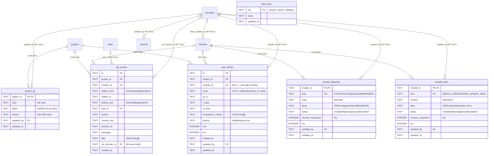

# ERD – BA Copilot v2

Người viết: **A2**. Trạng thái: **chờ A0 duyệt**. Sau khi duyệt, tài liệu này **bị khoá**: muốn đổi phải mở yêu cầu với A0 (`docs/agents/REQUESTS.md`).

Nguồn sự thật là `ba-copilot-source/ba-copilot/server/db.ts` (`SCHEMA` + `COLUMNS`). `tests/contract.test.ts` kiểm tra bảng, cột, index, khoá ngoại và `ON DELETE` khớp với tài liệu này.

## 1. Sơ đồ

Nhãn trên cạnh là hành vi `ON DELETE` của khoá ngoại phía bảng con. Cạnh nét đứt (`..`) là tham chiếu **logic**, không có khoá ngoại trong DB.

```mermaid
erDiagram
  projects ||--o{ modules : "CASCADE"
  modules ||--o{ screens : "CASCADE"
  screens ||--o{ screen_versions : "CASCADE"
  screens ||--o{ annotations : "CASCADE"
  modules ||--o{ use_cases : "CASCADE"
  modules ||--o{ requirements : "CASCADE"
  modules ||--o| srs : "CASCADE"
  modules ||--o{ sequences : "CASCADE"
  modules ||--o{ test_cases : "CASCADE"
  modules |o..o{ prompt_runs : "logic"
  screens ||..o{ suggestion_events : "logic"
  screen_versions ||..o| model_learned_trees : "logic"

  projects ||--o{ files : "CASCADE"
  modules |o--o{ files : "SET NULL"
  members |o--o{ files : "uploaded_by SET NULL"
  members |o--o{ screen_versions : "author_id SET NULL"
  members |o--o{ annotations : "author_id SET NULL"
  modules ||--o| uc_diagrams : "CASCADE"
  projects ||--o{ tasks : "CASCADE"
  modules |o--o{ tasks : "SET NULL"
  members |o--o{ tasks : "assignee_id SET NULL"
  tasks ||--o{ task_events : "CASCADE"
  members |o--o{ task_events : "by_member_id SET NULL"
  modules ||--o{ suggestion_dismissals : "CASCADE"

  projects {
    TEXT id PK
    TEXT name
    TEXT description
    TEXT created_at
  }
  modules {
    TEXT id PK
    TEXT project_id FK
    TEXT name
    TEXT requirement_input
    TEXT docs_status "none|draft|approved|outdated"
    TEXT tests_status "none|draft|approved|outdated"
    INTEGER qus_score "v2, NULL = chưa chấm"
    TEXT qus_checked_at "v2"
    TEXT created_at
  }
  screens {
    TEXT id PK
    TEXT module_id FK
    TEXT name
    TEXT status "draft|approved"
    TEXT current_version_id
    TEXT created_at
  }
  screen_versions {
    TEXT id PK
    TEXT screen_id FK
    INTEGER number
    TEXT kind "generate|edit|revert|layout|manual"
    TEXT prompt
    TEXT scope
    TEXT selected_ids "JSON"
    TEXT changed_ids "JSON"
    TEXT rejected "JSON"
    TEXT tree "JSON UINode"
    TEXT author "v2, tên chụp lại"
    TEXT author_id FK "v2"
    TEXT created_at
  }
  annotations {
    TEXT id PK
    TEXT screen_id FK
    TEXT version_id
    TEXT node_ids "JSON"
    TEXT bbox "JSON"
    TEXT comment
    TEXT author
    TEXT author_id FK "v2"
    TEXT status "open|sent|resolved"
    TEXT created_at
  }
  use_cases {
    TEXT module_id PK,FK
    TEXT code PK
    INTEGER ord
    TEXT data "JSON UseCase"
  }
  requirements {
    TEXT module_id PK,FK
    TEXT code PK
    INTEGER ord
    TEXT data "JSON Requirement"
  }
  srs {
    TEXT module_id PK,FK
    TEXT data "JSON SrsDoc"
  }
  sequences {
    TEXT module_id PK,FK
    TEXT use_case_code PK
    INTEGER ord
    TEXT data "JSON SequenceDiagram"
  }
  test_cases {
    TEXT module_id PK,FK
    TEXT code PK
    INTEGER ord
    TEXT data "JSON TestCase"
  }
  prompt_runs {
    TEXT id PK
    TEXT module_id "logic"
    TEXT type
    TEXT provider
    TEXT model
    TEXT input
    TEXT output
    INTEGER ok
    TEXT error
    INTEGER input_tokens
    INTEGER output_tokens
    INTEGER latency_ms
    TEXT created_at
  }
  suggestion_events {
    TEXT id PK
    TEXT screen_id "logic"
    TEXT version_id
    TEXT suggestion_kind
    TEXT target_node_id
    TEXT title
    REAL confidence
    TEXT action "shown|applied|dismissed"
    TEXT created_at
  }
  model_learned_trees {
    TEXT version_id PK "logic"
    TEXT screen_id
    TEXT tree "JSON"
    TEXT created_at
  }
  files {
    TEXT id PK
    TEXT project_id FK
    TEXT module_id FK "NULL = cấp dự án"
    TEXT name
    TEXT stored_name
    TEXT mime
    INTEGER size
    TEXT source "upload|export"
    TEXT sender "v2"
    TEXT received_at "v2"
    TEXT note "v2"
    TEXT uploaded_by FK "v2"
    TEXT created_at
  }
  members {
    TEXT id PK
    TEXT name
    TEXT role "BA|BA_LEAD"
    TEXT created_at
  }
  uc_diagrams {
    TEXT module_id PK,FK
    TEXT code "Mermaid"
    TEXT status "draft|approved|stale"
    TEXT approved_at
    TEXT updated_at
  }
  tasks {
    TEXT id PK
    TEXT project_id FK
    TEXT module_id FK
    TEXT title
    TEXT description
    TEXT assignee_id FK
    TEXT due_date "YYYY-MM-DD"
    TEXT priority "High|Medium|Low"
    TEXT status "todo|doing|done|redo"
    TEXT artifact_type "screen|docs|diagram|tests"
    TEXT artifact_id "logic"
    TEXT created_at
    TEXT updated_at
  }
  task_events {
    TEXT id PK
    TEXT task_id FK
    TEXT from_status "NULL = lúc tạo"
    TEXT to_status
    TEXT by_member_id FK
    INTEGER by_system "0|1"
    TEXT reason
    TEXT created_at
  }
  suggestion_dismissals {
    TEXT module_id PK,FK
    TEXT key PK
    TEXT created_at
  }
```

## 2. Nhóm bảng

| Nhóm | Bảng | Ghi chú |
|---|---|---|
| 11 bảng cũ (bản 4 ngày) | `projects`, `modules`, `screens`, `screen_versions`, `annotations`, `use_cases`, `requirements`, `srs`, `sequences`, `test_cases`, `prompt_runs` | Giữ nguyên, chỉ thêm cột (mục 3) |
| Gợi ý thành phần ML (nhánh `trung_ba`) | `suggestion_events`, `model_learned_trees` | Không đổi, ngoài phạm vi v2 |
| Kho tài liệu (nhánh `htrung-c4`) | `files` | Đã có, thêm cột nguồn (mục 3) |
| Mới ở v2 | `members`, `uc_diagrams`, `tasks`, `task_events`, `suggestion_dismissals` | Tạo bằng `CREATE TABLE IF NOT EXISTS` |
| Mới ở đợt 5 | `app_meta`, `user_stories`, `module_docs`, `module_diagrams`, `project_git`, `git_pushes` | Mục 8 |

## 3. Cột thêm vào bảng đã có (`migrate()`)

`migrate()` đọc `PRAGMA table_info`, thiếu cột nào thì `ALTER TABLE … ADD COLUMN` cột đó. Gọi nhiều lần không lỗi, `openDb()` gọi mỗi lần mở DB, nên DB cũ trong `data/` được nâng cấp tự động mà không mất dữ liệu.

| Bảng.cột | Kiểu | Mặc định | Phục vụ |
|---|---|---|---|
| `modules.qus_score` | INTEGER NULL | NULL | FN-56 |
| `modules.qus_checked_at` | TEXT NULL | NULL | FN-56 |
| `screen_versions.author` | TEXT | `''` | FN-03 |
| `screen_versions.author_id` | TEXT NULL → `members(id)` ON DELETE SET NULL | NULL | FN-03 |
| `annotations.author_id` | TEXT NULL → `members(id)` ON DELETE SET NULL | NULL | FN-03 |
| `files.sender` | TEXT | `''` | FN-05 (stakeholder gửi) |
| `files.received_at` | TEXT NULL | NULL | FN-05 (ngày nhận) |
| `files.note` | TEXT | `''` | FN-05 |
| `files.uploaded_by` | TEXT NULL → `members(id)` ON DELETE SET NULL | NULL | FN-03, FN-05 |

SQLite chỉ cho `ADD COLUMN … REFERENCES` khi mặc định là NULL, vì vậy mọi cột khoá ngoại thêm sau đều cho phép NULL.

## 4. Khoá ngoại mới và lý do chọn `ON DELETE`

| Bảng con.cột | → Bảng cha | ON DELETE | Lý do |
|---|---|---|---|
| `tasks.project_id` | `projects` | CASCADE | Xoá dự án thì xoá luôn công việc |
| `tasks.module_id` | `modules` | SET NULL | Xoá module không làm mất task; task còn ở cấp dự án |
| `tasks.assignee_id` | `members` | SET NULL | API chặn xoá người đang giữ task mở (409). Task đã xong thì bỏ trống người làm |
| `task_events.task_id` | `tasks` | CASCADE | Lịch sử đi cùng task |
| `task_events.by_member_id` | `members` | SET NULL | Giữ lịch sử khi xoá thành viên |
| `uc_diagrams.module_id` | `modules` | CASCADE | Mỗi module có tối đa 1 sơ đồ |
| `suggestion_dismissals.module_id` | `modules` | CASCADE | |
| `files.uploaded_by`, `screen_versions.author_id`, `annotations.author_id` | `members` | SET NULL | Giữ dữ liệu; tên vẫn còn trong cột `author` |

## 5. Tham chiếu logic (không có khoá ngoại)

| Cột | Trỏ tới | Quy ước |
|---|---|---|
| `tasks.artifact_type` + `tasks.artifact_id` | `screens.id` khi `screen`; `modules.id` khi `docs`, `tests`, `diagram` | Có index `(artifact_type, artifact_id)` để tìm task theo sản phẩm (A7). Xoá màn không xoá task; agent A6 hiển thị "sản phẩm không còn" |
| `suggestion_dismissals.key` | gợi ý của `shared/suggest.ts` | `link:<screenId>:<nodeId>`, `fr:<code>`, `story:<hash>` |
| `prompt_runs.module_id`, `suggestion_events.screen_id`, `model_learned_trees.version_id` | như tên cột | Giữ như bản cũ |

## 6. Index

Cũ: `idx_modules_project`, `idx_screens_module`, `idx_versions_screen`, `idx_ann_screen`, `idx_runs_module`, `idx_sugg_screen`, `idx_files_project`, `idx_files_module` (`files(module_id)`).

Mới: `idx_tasks_project` (`tasks(project_id)`), `idx_tasks_artifact` (`tasks(artifact_type, artifact_id)`), `idx_task_events_task` (`task_events(task_id)`).

## 7. Ràng buộc giá trị (CHECK)

| Cột | Giá trị |
|---|---|
| `members.role` | `BA`, `BA_LEAD` |
| `uc_diagrams.status` | `draft`, `approved`, `stale` |
| `tasks.status` | `todo` (Cần làm), `doing` (Đang làm), `done` (Xong), `approved` (Đã duyệt, đợt 5), `redo` (cũ – migration đổi thành `doing` + cờ, xem mục 8) |
| `tasks.priority` | `High`, `Medium`, `Low` (cùng bộ giá trị với `Requirement.priority`) |
| `tasks.artifact_type` | `screen`, `doc`, `diagram`, `tests` (đợt 5), `docs` (cũ) hoặc NULL |

---

## 8. Đợt 5 (C2)

Người viết: **C2**. Kế hoạch: `docs/Ke_hoach_Agent_BA_Copilot_v2_dot5.md`. Kiểu: `shared/types.ts` khối "Đợt 5". Không xoá cột/bảng cũ nào (`requirement_input`, `use_cases`, `requirements`, `srs`, `sequences`, `uc_diagrams`, `modules.docs_status` vẫn được màn cũ đọc tới khi đợt 2 thay xong).

### 8.1 Sơ đồ bảng mới

### 8.2 Cột thêm vào bảng đã có (`COLUMNS` + `migrate()`)

| Bảng.cột | Kiểu | Mặc định | Phục vụ |
|---|---|---|---|
| `members.password_hash` | TEXT NULL | NULL | Đăng nhập thành viên (`scrypt$<salt>$<hash>`, `server/http.ts`). **Không bao giờ** trả ra API |
| `screens.rev` | INTEGER | `1` | Chặn đè màn |
| `screens.revision_requested` | INTEGER 0/1 | `0` | Tag "Yêu cầu sửa" |
| `screens.updated_by` | TEXT NULL → `members(id)` SET NULL | NULL | Người sửa cuối |
| `screens.updated_at` | TEXT NULL | NULL | Lúc sửa cuối |
| `modules.tests_rev` | INTEGER | `0` | Chặn đè bộ test case |
| `modules.tests_revision_requested` | INTEGER 0/1 | `0` | Tag "Yêu cầu sửa" của bộ test |
| `modules.tests_updated_by` | TEXT NULL → `members(id)` SET NULL | NULL | |
| `modules.tests_updated_at` | TEXT NULL | NULL | |
| `tasks.revision_requested` | INTEGER 0/1 | `0` | Tag "Yêu cầu sửa" của task (có từ lần dựng lại bảng, mục 8.3) |
| `tasks.artifact_sub` | TEXT NULL | NULL | `DocKind`/`DiagramKind` khi `artifact_type` là `doc`/`diagram` |

`migrate()` bỏ qua bảng chưa tồn tại (SCHEMA tạo bảng mới đủ cột).

### 8.3 Nâng cấp bảng `tasks`

SQLite không sửa được CHECK, nên `upgradeTasksTable()` (trong `server/db.ts`) dựng lại bảng khi CHECK chưa có `'approved'` hoặc thiếu cột `artifact_sub`: tắt `foreign_keys` → tạo `tasks__d5` theo định nghĩa mới → chép dữ liệu (`redo` → `doing` + `revision_requested = 1`) → xoá bảng cũ → đổi tên → tạo lại 2 index → `PRAGMA foreign_key_check` → bật lại `foreign_keys`. `task_events` không bị xoá theo (đã có test). CHECK mới: `status IN ('todo','doing','done','approved','redo')`, `artifact_type IN ('screen','doc','diagram','tests','docs')`. `redo` và `docs` còn trong CHECK chỉ để mã v2 (taskRules của A7) chạy được tới khi C7 thay; mỗi lần khởi động `UPDATE tasks SET status = 'doing', revision_requested = 1 WHERE status = 'redo'`.

### 8.4 Chuyển dữ liệu cũ (`migrateData()`, chạy khi mở DB)

Mỗi bước chạy **một lần cho mỗi DB** (đánh dấu `migration:<bước>` trong `app_meta`), trong transaction riêng:

| Bước | Nguồn → Đích | Trạng thái |
|---|---|---|
| `d5.docs` | `use_cases` → `module_docs` UC_SPEC (`data.useCases` + Markdown); `requirements` → FRD_NFR (`data.requirements`); `srs` → SRS (`data.srs`) | theo `modules.docs_status` (`none` → `draft`) |
| `d5.diagrams` | `sequences` → `module_diagrams` SEQUENCE (`parts`, `code` rỗng); `uc_diagrams` → UC | SEQUENCE theo `docs_status`; UC: `stale` → `outdated` |
| `d5.stories` | `modules.requirement_input` → `user_stories` (tách bằng `splitStories`, đọc "As a … I want … so that …" / "Là …, tôi muốn … để …" bằng `parseStoryParts`; không khớp thì cả câu vào `i_want`) | mã `US-xx` đánh tiếp theo dự án, ưu tiên `Medium`; chỉ module chưa có story |

Module tạo sau lần chuyển (bằng màn cũ) không tự sinh story – C4 lo khi thay màn tạo module.

### 8.5 Ánh xạ trạng thái sản phẩm (`getArtifactState` / `setArtifactState` / `bumpRev` trong `server/db.ts`)

| `ArtifactRef` | Bảng | status | revisionRequested | rev |
|---|---|---|---|---|
| `screen`, id = screenId | `screens` | `status` | `revision_requested` | `rev` |
| `doc`, id = moduleId, sub | `module_docs` (`kind = sub`) | `status` | `revision_requested` | `rev` |
| `diagram`, id = moduleId, sub (mặc định UC) | `module_diagrams` (`kind = sub`) | `status` | `revision_requested` | `rev` |
| `tests`, id = moduleId | `modules` | `tests_status` | `tests_revision_requested` | `tests_rev` |
| `docs` (cũ), id = moduleId | `modules` | `docs_status` | – | – |

Tài liệu/sơ đồ chưa có dòng → `status "none"`, `rev 0`. Đổi trạng thái không tăng `rev`; chỉ ghi nội dung mới tăng.
